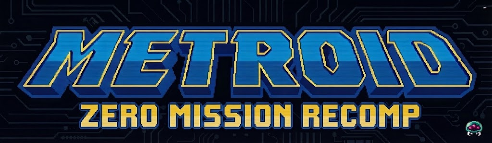
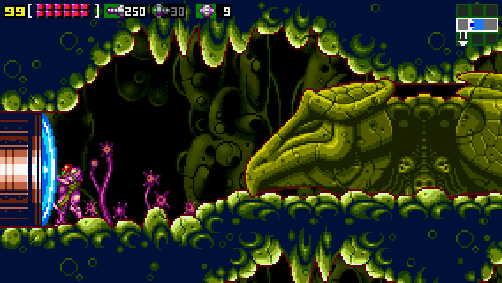
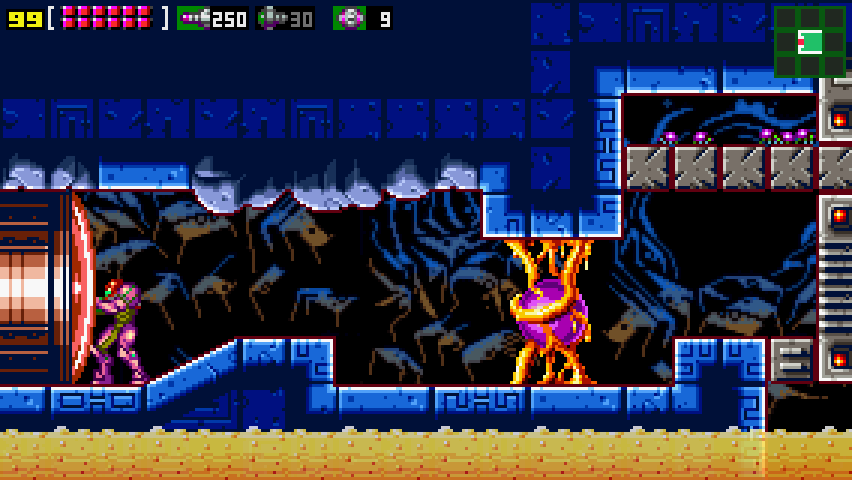
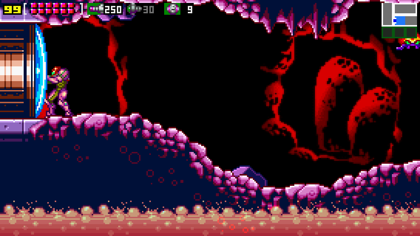
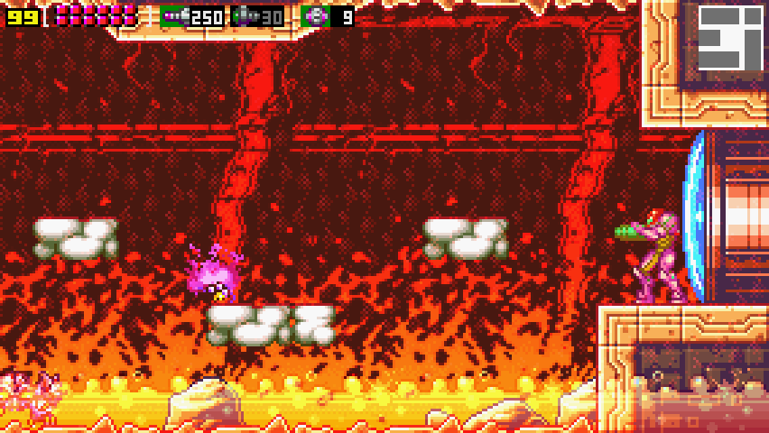
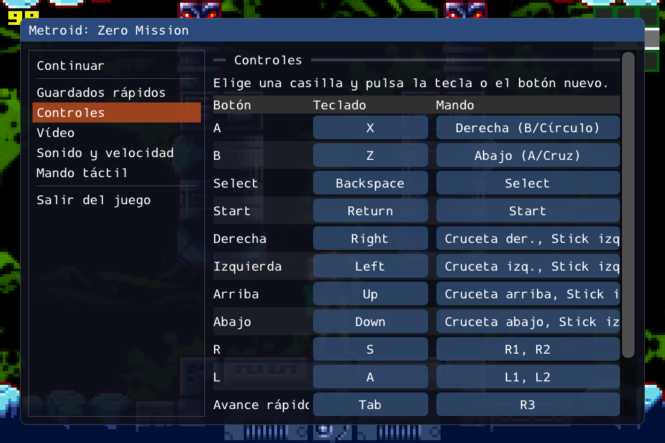

<p align="center">
  
</p>

<h1 align="center">metroid-zm-recomp</h1>

<p align="center">
  <b>Metroid: Zero Mission, running natively on Android and PC.</b><br>
  No emulator: the game's own C code, compiled for your device, with widescreen, save states and touch controls.
</p>

<p align="center">
  <a href="https://github.com/kalasyan/metroid-zm-recomp/actions/workflows/build.yml"></a>
  
  
  
  
</p>

---

## ✨ What is this?

**metroid-zm-recomp** turns *Metroid: Zero Mission* (GBA) into a native app for
Android and PC. It is built on top of the
[metroidret/mzm](https://github.com/metroidret/mzm) decompilation: the game's C
code is compiled directly for ARM64 / x86-64, and a thin layer in `port/`
provides the "console" (video, DMA, interrupts, BIOS).

The graphics, levels, text and sound are read from **your own ROM** at
startup, so the repository and the APKs contain no game data.

> 🤖 **AI notice:** this project was developed with the help of AI tools
> (Anthropic's Claude), which wrote most of the code and documentation under
> my direction and review.

## 📸 Screenshots

<p align="center">
  
  
  
  
</p>
<p align="center"><i>16:9 widescreen: more of each room on the sides, with the game itself unchanged.</i></p>

<p align="center">
  
</p>
<p align="center"><i>The options menu (controls tab).</i></p>

## 🎮 Features

- 📱 **Native Android app** (arm64 + x86_64), with a touch gamepad you can rearrange and resize.
- 🖥️ **Widescreen:** 16:10, 16:9, 2:1 or match your display. Menus, map and cutscenes stay at 3:2 in the center.
- 💾 **Quick saves:** 4 slots with thumbnail and date (`F5` / `F8`), on top of the normal in-game save.
- 🎨 **Video options:** fullscreen, integer scaling, smooth filter, LCD grid or CRT scanlines, VSync.
- 🌊 **Smoothness options:** match the game speed to 60/120 Hz displays, or frame blending for 90/144 Hz.
- 🔊 **Sound and fast-forward** (x2 to x10, hold or toggle).
- 🎮 **Gamepad support** with remappable buttons, stick dead zone and rumble.
- 🗺️ **Second screen:** the area map or Samus's status on the bottom screen of dual-screen devices (AYN Thor) or in a second window on PC.
- 🌍 **Europe, USA and Japan** builds. The European version keeps its language selection.
- 💽 **GBA-compatible saves:** an mGBA `.sav` of the USA version works as-is.
- 🚫 **No BIOS and no emulator needed.**

## 💽 You need your own ROM

There is one build per region, and each one only accepts its own ROM:

| Region | Build | SHA-1 |
| --- | --- | --- |
| Europe | `eu` | `0fd107445a42e6f3a3e5ce8c865f412583179903` |
| USA | `us` | `5de8536afe1f0078ee6fe1089f890e8c7aa0a6e8` |
| Japan | `jp` | `096f07685a3dc9286e71aa0b761f233b5efa2fcd` |

On first launch the app asks for your `.gba` and copies it to its private
storage. The Japanese build compiles and passes the smoke test, but has not
been tested with the real ROM yet (see [docs/PORT.md](docs/PORT.md)).

## 🚀 Installation (Android)

Download an APK from the
**[latest release](https://github.com/kalasyan/metroid-zm-recomp/releases/latest)**:

- `Metroid_Zero_Mission-eu.apk` for the European ROM
- `Metroid_Zero_Mission-us.apk` for the American ROM
- `Metroid_Zero_Mission-jp.apk` for the Japanese ROM

Builds of every push to `main` are also in
**[Actions → build](https://github.com/kalasyan/metroid-zm-recomp/actions/workflows/build.yml)**
(the `mzm-android-apk` artifact of the latest run).

They can be installed side by side. Open *Zero Mission (EU)*, *(US)* or *(JP)*
and pick your ROM with the file picker. ▶️

## 🕹️ Controls

> 💡 The **options menu** pauses the game and opens with **Esc** or **F1**,
> **Select+Start** (or Guide) on a gamepad, the Android **Back** button, or the
> `=` button on the touch controls.

| GBA | Keyboard | Gamepad |
| --- | --- | --- |
| A / B | X / Z | right / bottom face button |
| L / R | A / S | bumpers or triggers |
| Start / Select | Enter / Backspace | Start / Back |
| D-pad | arrow keys | D-pad or left stick |
| Fast-forward | Tab (hold) | right stick click |
| Quick save / load | F5 / F8 | |
| Fullscreen | F11 | |

Every button can be remapped from the menu. On touchscreens a virtual gamepad
appears (`touch_controls = auto | on | off`) and hides when a physical
controller is used. The game's reset (A+B+Select+Start) still works if A and B
are pressed first.

Settings live in `settings.ini` in the app's data folder (Linux:
`~/.local/share/mzm-android/mzm/`), created with the default values on first
launch.

## 🔨 Building from source

### Android

```sh
cd android
./gradlew assembleEuRelease   # or assembleUsRelease / assembleJpRelease
```

### PC (Linux)

Requirements: CMake ≥ 3.22, Ninja, Python 3, a C11 compiler and SDL3 (if it is
not installed, CMake downloads and builds it).

```sh
cmake -B build -G Ninja -DMZM_REGION=eu   # or us / jp
cmake --build build
./build/mzm path/to/your_rom.gba
```

Each region keeps its own save and copy of the ROM (`mzm_eu.sav`,
`rom_eu.gba`...).

### Headless (tests / CI)

`-DMZM_HOST=headless` builds `mzm_headless`, which dumps frames to PPM:

```sh
./build/mzm_headless --rom mzm_us_baserom.gba --frames 1200 --dump-every 60 \
    --press 400:S:5      # press Start at frame 400 for 5 frames
```

`--state-save FRAME:FILE` / `--state-load FRAME:FILE` save or load a state at
that frame, and `--width 284` renders in 16:9. The `MZM_WARP` test mode jumps
straight to any room or cutscene; it is described in
[docs/PORT.md](docs/PORT.md).

## 🧩 How it is built

- `src/`, `include/`: the decompilation. Changes for the native build are
  wrapped in `#ifdef PLATFORM_PC` and do not alter the GBA ROM.
- `port/src/`: emulated memory, DMA, BIOS in C, frame loop with
  VBlank/HBlank/VCount IRQs, ROM loading, save states and frontends (SDL3 with
  the menu in [Dear ImGui](https://github.com/ocornut/imgui), and headless).
- `port/ppu/`: software PPU from [Project Picori](https://github.com/999sian/tmc)
  (the native port of Minish Cap).
- `tools/port/gen_assets.py`: compiles the data in `src/data` zero-filled and
  generates the registry that fills it from the ROM at startup.
- `android/`: Gradle project (SDL3 + `libmain.so`).

Details in [docs/PORT.md](docs/PORT.md).

## 🙏 Credits and licenses

- Decompilation: [metroidret/mzm](https://github.com/metroidret/mzm) (MIT,
  [LICENSE](LICENSE)). Its original README is in
  [docs/UPSTREAM_README.md](docs/UPSTREAM_README.md).
- Port layer: GPL-3.0 ([port/LICENSE](port/LICENSE)).
- Software PPU: [Project Picori](https://github.com/999sian/tmc).
- Sister project: [metroid-fs-recomp](https://github.com/kalasyan/metroid-fs-recomp) (Metroid Fusion).

Metroid is a trademark of Nintendo. This project is not affiliated with
Nintendo and does not include or distribute any of its property.
